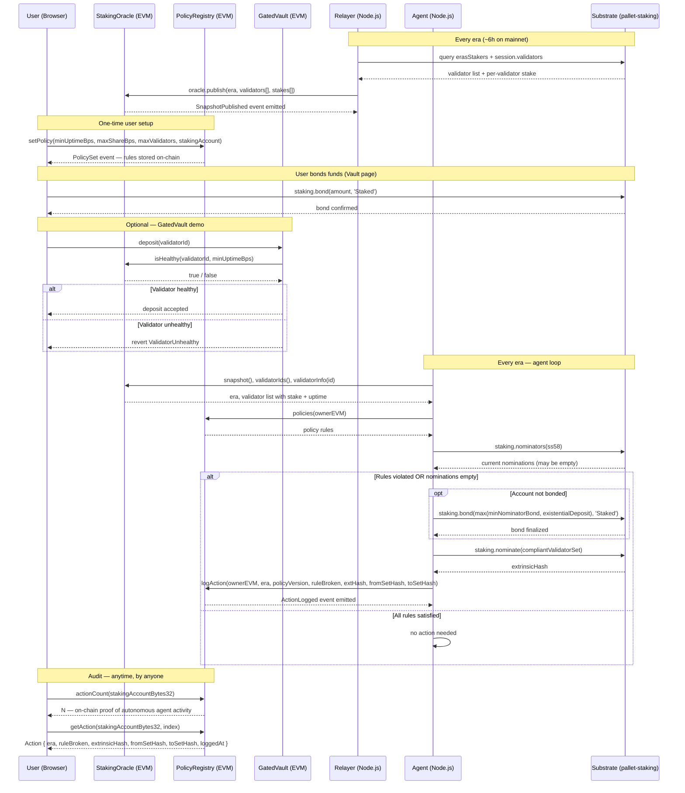

# Potake

Potake automates Polkadot staking — you set rules once (min uptime, max stake concentration, max validators) and the agent re-nominates every era to keep your nominations compliant, with every action logged on-chain as immutable proof.

Built on **Portaldot V3** (pallet-revive / PolkaVM) · Portaldot Hacker House 2026 · Node Operations & Tooling track

---

## The Problem

Polkadot staking is entirely manual today.

When you nominate validators on Polkadot you pick a set of validators by hand. There is no automatic rebalancing. If any nominated validator goes offline, gets slashed, or becomes over-subscribed — **nothing happens automatically**. You have to check back every era (~6 hours on mainnet) and re-nominate by hand. The [Polkadot Wiki on Nomination](https://wiki.polkadot.network/docs/learn-nominator) documents this expectation explicitly — nominators are responsible for actively monitoring validator performance and updating their nominations when it degrades.

Most stakers set their nominations once and forget. The result is:

- Missed rewards when a validator goes inactive
- Slash exposure when a validator misbehaves
- Over-concentration of stake on a few popular validators, weakening decentralisation ([Web3 Foundation NPoS research](https://research.web3.foundation/Polkadot/protocols/NPoS))

The second problem is on the builder side. On **Portaldot V3**, Solidity contracts running in PolkaVM cannot read staking data at all. There are no EVM precompiles for validators, eras, or staking rewards. Builders cannot make staking-aware apps, and stakers have no verifiable on-chain record of why their nominations changed.

---

## The Solution

Potake is a **policy-driven, autonomous nomination agent** with on-chain proof of every action it takes.

**You set rules once:**

> "Never nominate a validator with uptime below 95%.  
> Never let one validator hold more than 50% of my stake.  
> Nominate at most 16 validators."

Rules are stored in the `PolicyRegistry` smart contract on-chain under your EVM address.

**The agent enforces them every era:**

1. Reads the latest validator snapshot from `StakingOracle`
2. Reads your policy rules from `PolicyRegistry`
3. Reads your current nominations from the Substrate staking pallet
4. Checks all rules — if any is violated (or nominations are empty), picks a compliant set
5. Signs and submits `staking.nominate` on the Substrate side
6. Calls `registry.logAction(era, ruleBroken, extrinsicHash, fromSet, toSet)` — an immutable on-chain record

Anyone — including hackathon judges — can query `registry.actionCount(stakingKey)` on-chain and see proof that the agent acted autonomously without human intervention.

---

## How It Works — End to End

| Phase | What happens |
|-------|-------------|
| **1. Deploy** | `StakingOracle`, `PolicyRegistry`, `GatedVault` deployed to Portaldot V3 via `revive.instantiateWithCode` |
| **2. Set policy** | User opens Policy page → sets minUptime, maxShare, maxValidators → signs EVM tx → `PolicyRegistry.setPolicy()` stores rules on-chain |
| **3. Bond funds** | User opens Vault page → bonds tPOT on Substrate so the account can nominate |
| **4. Relayer** | Every era: reads `erasStakers` + `session.validators` from Substrate → calls `oracle.publish(era, validators, stakes)` |
| **5. Agent evaluates** | Reads oracle snapshot + policy rules + current nominations → checks 3 rules |
| **6. Agent acts** | On any violation: auto-bonds if needed → submits `staking.nominate(compliantSet)` → calls `registry.logAction(...)` |
| **7. Audit** | `registry.actionCount(key)` and `registry.getAction(key, i)` give full immutable history: era, rule broken, extrinsic hash, before/after nomination sets |

---

## Architecture

```
┌──────────────────────────────────────────────────────────────────────┐
│                          Browser (Next.js 14)                         │
│                                                                        │
│   Landing page  ──►  Dashboard                                         │
│                        ├── Oracle page  (live validator data,          │
│                        │                 agent action counter)         │
│                        ├── Policy page  (set staking rules on-chain)   │
│                        └── Vault page   (GatedVault deposit demo)     │
│                                                                        │
│   WalletButton (RainbowKit)  ──  wagmi v2  ──  ethers v6               │
│   WorldCanvas (Three.js 3D)  visible on every dashboard page           │
└────────────────────────────┬─────────────────────────────────────────┘
                             │ EVM transactions + eth_call
                             ▼
┌──────────────────────────────────────────────────────────────────────┐
│                  Portaldot V3 — EVM layer (pallet-revive / PolkaVM)   │
│                                                                        │
│  ┌─────────────────────┐   ┌──────────────────────────────────────┐  │
│  │   StakingOracle.sol  │   │          PolicyRegistry.sol           │  │
│  │                      │   │                                       │  │
│  │  snapshot()          │   │  setPolicy(...)                       │  │
│  │  validatorIds()      │   │  policies(owner)  → rules             │  │
│  │  validatorInfo(id)   │   │  logAction(...)   → append-only log   │  │
│  │  isHealthy(id, bps)  │   │  actionCount(key) → on-chain proof    │  │
│  │  stakeShareBps(id)   │   │  getAction(key, i)  → full audit trail  │  │
│  └──────────┬───────────┘   └──────────────────────────────────────┘  │
│             │ IStakingView                                              │
│  ┌──────────▼───────────┐                                              │
│  │     GatedVault.sol   │  ← demo: deposit only if validator healthy   │
│  └──────────────────────┘                                              │
└──────────┬──────────────────────────────────┬───────────────────────-┘
           │ eth_call / eth_sendTransaction    │ eth_call / logAction
           ▼                                   ▼
┌──────────────────────┐       ┌──────────────────────────────────────┐
│  Relayer (Node.js)    │       │         Agent (Node.js)               │
│                       │       │                                       │
│  Every era:           │       │  Every era:                           │
│  1. query Substrate   │       │  1. reads oracle snapshot             │
│  2. publish to oracle │       │  2. reads policy rules                │
│                       │       │  3. reads current nominations         │
│                       │       │  4. evaluates 3 rules                 │
│                       │       │  5. if violated:                      │
│                       │       │     a. bond (if not bonded)           │
│                       │       │     b. staking.nominate(compliantSet) │
│                       │       │     c. registry.logAction(...)        │
└──────────┬────────────┘       └──────────────────┬───────────────────┘
           │                                        │
           │ query erasStakers, session.validators  │ extrinsic: staking.nominate
           ▼                                        ▼
┌──────────────────────────────────────────────────────────────────────┐
│               Portaldot V3 — Substrate layer (pallet-staking)         │
│                                                                        │
│  erasStakers  ·  session.validators  ·  staking.nominators             │
│  staking.bond  ·  staking.nominate                                     │
└──────────────────────────────────────────────────────────────────────┘
```

---

## Sequence Diagram



---

## Smart Contracts

### `IStakingView` — Stable Read Interface

The consumer-facing interface. All contracts that need staking data depend only on this. If Portaldot V3 ever ships a native staking precompile, a new implementation swaps in behind this interface without changing any consumer.

```solidity
interface IStakingView {
    struct Snapshot {
        uint32  era;
        uint64  relayedAt;
        uint16  validatorCount;
        bytes32 validatorSetHash;
        uint256 totalStake;       // network-wide, 14 decimals
        uint256 eraReward;
    }
    struct ValidatorInfo {
        uint128 totalStake;
        uint16  commissionBps;
        uint16  uptimeBps;
        bool    active;
    }
    function snapshot()                                         external view returns (Snapshot memory);
    function validatorIds()                                     external view returns (bytes32[] memory);
    function validatorInfo(bytes32 validator)                   external view returns (ValidatorInfo memory);
    function isHealthy(bytes32 validator, uint16 minUptimeBps) external view returns (bool);
    function stakeShareBps(bytes32 validator)                   external view returns (uint16);
}
```

### `StakingOracle`

Holds the latest per-era validator snapshot published by the relayer. Only one snapshot is stored — overwritten each era — and history lives in events. This avoids unbounded storage deposit growth under Revive.

| Function | Caller | Purpose |
|----------|--------|---------|
| `publish(era, ids[], stakes[], commissions[], uptimes[], actives[])` | relayer | Overwrites snapshot; emits `SnapshotPublished` |
| `snapshot()` | anyone | Latest `Snapshot` struct |
| `validatorIds()` | anyone | All listed validator `AccountId32`s as `bytes32[]` |
| `isHealthy(id, bps)` | GatedVault, agent | True if validator is active and uptime ≥ threshold |
| `stakeShareBps(id)` | agent | Validator's share of total stake in basis points |

### `PolicyRegistry`

Stores each user's staking policy and an append-only log of every action the agent takes.

**Policy fields:** `stakingAccount` (Substrate AccountId32 as bytes32), `maxShareBps`, `minUptimeBps`, `maxValidators`, `version` (auto-increments), `active`

**Action log fields:** `era`, `policyVersion`, `ruleBroken`, `extrinsicHash` (Substrate nominate tx), `fromSetHash`, `toSetHash`, `loggedAt`

| Function | Caller | Purpose |
|----------|--------|---------|
| `setPolicy(stakingAccount, maxShareBps, minUptimeBps, maxValidators)` | user | Stores rules on-chain; increments version |
| `logAction(owner, era, version, rule, extHash, fromHash, toHash)` | agent | Appends immutable action record |
| `actionCount(stakingAccount)` | anyone | Number of agent actions — **on-chain proof** |
| `getAction(stakingAccount, index)` | anyone | Full action detail by index |

### `GatedVault` — Demo Consumer

Shows any EVM contract can compose with `IStakingView`. Accepts a deposit earmarked for a validator only if `oracle.isHealthy(validatorId, minUptimeBps)` returns true — rejects with `ValidatorUnhealthy` otherwise. A lending protocol, liquid staking vault, or yield optimizer could use the same pattern.

---

## Frontend

Built with Next.js 14 App Router, wagmi v2, RainbowKit, ethers v6, Three.js.

### Policy Page

Where users define their staking rules on-chain. Set `minUptimeBps` (minimum validator uptime, e.g. `9500` = 95%), `maxShareBps` (max stake concentration on one validator, e.g. `5000` = 50%), and `maxValidators` (nomination cap). Submitting calls `registry.setPolicy(...)` — an EVM transaction stored permanently under the user's address. The agent reads this every era and acts strictly within its constraints. The user, not the agent, defines what "compliant" means.

### Vault Page

A demo of the `GatedVault` contract — an `IStakingView` consumer that only accepts a deposit if the chosen validator is currently healthy according to the oracle. Select a validator from the list, enter an amount, and submit — the vault calls `oracle.isHealthy(validatorId, minUptimeBps)` on-chain and reverts with `ValidatorUnhealthy` if the validator does not meet the threshold. This exists to show that any EVM contract can compose with `IStakingView`; it does not manage bonded staking funds.

### Oracle Page

Live view of the oracle snapshot: current era, total stake, each validator with uptime and commission. The **Agent Nominations** counter polls `registry.actionCount(stakingKey)` every 15 seconds — this is a publicly verifiable, on-chain count of how many times the agent acted autonomously, independent of anything the frontend claims.

### WorldCanvas

A Three.js 3D scene rendered on every dashboard page — a LatheGeometry pot, CylinderGeometry validator pillars that grow with stake, and an agent sphere. Visual representation of the staking world the agent manages.

---

## Deployed Contracts (Portaldot V3 Testnet)

| Contract | Address |
|----------|---------|
| **StakingOracle** | `0x0bfB6f131A99D5aaA3071618FFBD5bb3ea87C619` |
| **PolicyRegistry** | `0x68283AAa8899A4aA299141ca6f04dF8e5802509f` |

> **Chain ID:** `420420777` · **EVM RPC:** `https://test-evm-rpc-v3.portaldot.dev` · **Substrate WS:** `wss://test-node-v3.portaldot.dev`

**Live activity on testnet:**
- Oracle: ERA 55, 2 validators, ~2.02 × 10¹⁸ planck total stake
- Policy active for `0x588F6b3169F60176c1143f8BaB47bCf3DeEbECdc` (v5: minUptime=9500, maxShare=5000, maxValidators=16)
- Agent bonded 10,000,000,000,000 planck and nominated 2 validators
- `actionCount` = 1 — verifiable on-chain, block `197667`

---

## Portaldot V3 Technologies Used

Potake is built directly on top of the Portaldot V3 stack. Below is every Portaldot-specific technology used and how Potake uses it.

| Technology | What it is | How Potake uses it |
|------------|-----------|-------------------|
| **pallet-revive** | Substrate pallet that executes EVM bytecode via PolkaVM ([docs](https://paritytech.github.io/revive/)) | All three smart contracts (`StakingOracle`, `PolicyRegistry`, `GatedVault`) run inside pallet-revive |
| **PolkaVM** | Register-based VM that executes compiled Solidity on Polkadot ([docs](https://github.com/paritytech/polkavm)) | Contracts are compiled with `resolc` (Revive's Solidity compiler) targeting PolkaVM |
| **`revive.instantiateWithCode`** | Substrate extrinsic for deploying EVM bytecode on pallet-revive ([docs](https://paritytech.github.io/revive/deployment.html)) | Deploy script calls this extrinsic instead of `eth_sendRawTransaction` — the only way to deploy on Portaldot V3 |
| **`@parity/resolc`** | Revive's Solidity → PolkaVM compiler (`v1.4.0`) ([npm](https://www.npmjs.com/package/@parity/resolc)) | Compiles all `.sol` contracts; `allowEVMBytecode: true` reduces storage deposit ~7× vs native PolkaVM bytecode |
| **EVM RPC (`eth_*`)** | Standard Ethereum JSON-RPC interface exposed by pallet-revive ([endpoint](https://test-evm-rpc-v3.portaldot.dev)) | Frontend and agent use `eth_call`, `eth_sendRawTransaction`, `eth_estimateGas` via ethers v6 |
| **Revive gas model** | `eth_estimateGas` returns Substrate weight units, not EVM gas | All contract calls run `provider.estimateGas()` and pass the result directly as `gasLimit` — never hard-coded |
| **Revive storage deposits** | Each new storage slot costs a tPOT deposit ([docs](https://paritytech.github.io/revive/storage.html)) | Oracle uses latest-slot overwrite (not append-only) to avoid unbounded deposit growth each era |
| **`api.call.reviveApi.address`** | Substrate RPC that converts an SS58 address to its EVM H160 counterpart | Agent uses this to resolve the EVM address for a Substrate account when looking up its policy |
| **`@polkadot/api`** | Polkadot JavaScript API for Substrate RPC + extrinsics ([docs](https://polkadot.js.org/docs/api/)) | Relayer reads `erasStakers`, `session.validators`; agent reads `staking.nominators`, submits `staking.bond` + `staking.nominate` |
| **pallet-staking** | Substrate pallet managing nominations, eras, and validator selection ([docs](https://docs.substrate.io/reference/frame-pallets/#staking)) | Agent submits `staking.bond` and `staking.nominate` extrinsics signed by an sr25519 keypair |
| **sr25519 keypair** | Schnorr/Ristretto signature scheme used natively on Polkadot ([docs](https://docs.substrate.io/reference/cryptography/)) | Agent loads a JSON keystore and signs Substrate extrinsics via `@polkadot/keyring` |

---

## Policy Rules

| Constant | Value | Meaning |
|----------|-------|---------|
| *(Rule 0)* | — | Zero nominations always triggers a violation |
| `RULE_MAX_SHARE` | `1` | No single nominated validator holds more than `maxShareBps` of total stake |
| `RULE_MIN_UPTIME` | `2` | Every nominated validator must have `uptimeBps ≥ minUptimeBps` |
| `RULE_MAX_VALIDATORS` | `3` | Total nominations must not exceed `maxValidators` |

Basis points: `10000 bps = 100%`. Example: `9500` = 95% uptime required.

---

## Key Design Decisions

**No staking precompile.** Portaldot V3 has no EVM precompile for staking data. The relayer bridges this by reading `erasStakers` on Substrate and writing it into `StakingOracle` via EVM transaction. Consumers only see `IStakingView` — if a native precompile ships later, only the implementation swaps.

**Latest-slot oracle storage.** The oracle overwrites one fixed snapshot per era; history lives in events. Append-only would grow storage slots every era, and Revive charges a deposit per slot.

**EVM bytecode deployment.** Contracts are deployed via `revive.instantiateWithCode` Substrate extrinsic. EVM bytecode with `allowEVMBytecode: true` costs ~238 tPOT storage deposit vs ~1,645 tPOT for PolkaVM bytecode — a 7× saving.

**Dynamic gas estimation.** Revive's `eth_estimateGas` returns Substrate weight units, not EVM gas. All contract calls run `provider.estimateGas()` and pass the result directly as `gasLimit`. Gas limits are never hard-coded.

**SS58 / EVM address split.** The policy is owned by an EVM address. The bonded stake lives on a separate Substrate SS58 account. The agent resolves both from config and from `policy.stakingAccount` stored in the registry.

**Auto-bond on first nomination.** If the staking account has no bond, the agent queries `minNominatorBond` and `existentialDeposit` from the chain and bonds `max(minBond, ed)` before nominating — a fresh funded account needs zero manual setup.

---

## Quick Start

```bash
cd backend && npm install
cp .env.example .env
# Fill: RELAYER_PRIVATE_KEY, ORACLE_ADDRESS, REGISTRY_ADDRESS,
#       MANAGED_ACCOUNTS, STAKING_ACCOUNT_SS58

npm test                                          # 28 unit tests

node src/index.mjs relay                          # start relayer
node src/index.mjs agent <keystore.json>          # run agent

cd ../frontend && npm install && npm run dev      # http://localhost:3000
```

---

## Project Structure

```
Potake/
├── backend/
│   ├── contracts/
│   │   ├── IStakingView.sol         read interface
│   │   ├── StakingOracle.sol        per-era validator snapshot
│   │   ├── PolicyRegistry.sol       user rules + action log
│   │   └── GatedVault.sol           demo IStakingView consumer
│   └── src/
│       ├── index.mjs                CLI entry (relay / agent / status)
│       ├── config.mjs               env vars
│       ├── chain/
│       │   ├── substrate.mjs        @polkadot/api connection
│       │   └── evm.mjs              ethers provider + contract factories
│       ├── relayer/                 Substrate → oracle publish loop
│       └── agent/
│           ├── index.mjs            orchestrator
│           ├── evaluate.mjs         rule evaluation + suggestion set
│           └── nominate.mjs         bond + nominate + logAction
└── frontend/
    ├── app/
    │   ├── page.tsx                 landing page
    │   └── (dashboard)/
    │       ├── layout.tsx           shared shell + 3D WorldCanvas
    │       ├── DashboardContext.tsx shared state (address, policy, snapshot)
    │       ├── oracle/page.tsx      live oracle + agent counter
    │       ├── policy/page.tsx      set staking policy
    │       └── vault/page.tsx       bond / unbond / withdraw
    └── components/
        ├── WorldCanvas.tsx          Three.js 3D scene
        ├── WalletButton.tsx         RainbowKit custom button
        ├── Providers.tsx            wagmi + RainbowKit providers
        └── TxLink.tsx               clickable tx hash chip
```

---

## Limits & Trust Model

The agent is a trusted off-chain service. The registry records what it did — it cannot force the agent to follow the policy. The registry does not prove the EVM address controls the Substrate staking account; that link is asserted by the user. The testnet has very few validators, so rules demonstrate guardrails and produce an audit trail but cannot optimise stake at scale. Uptime is currently hardcoded at 100% in oracle data; ImOnline-based uptime is a planned improvement.

---

## Third-party Software

Hardhat (MIT) · ethers.js v6 (MIT) · `@polkadot/api` v16 (Apache-2.0) · `@parity/resolc` v1.4.0 (Apache-2.0) · `@rainbow-me/rainbowkit` v2 (MIT) · wagmi v2 (MIT) · viem v2 (MIT) · Next.js 14 (MIT) · Three.js (MIT) · `@tanstack/react-query` v5 (MIT) · dotenv (BSD-2-Clause)

## License

MIT
