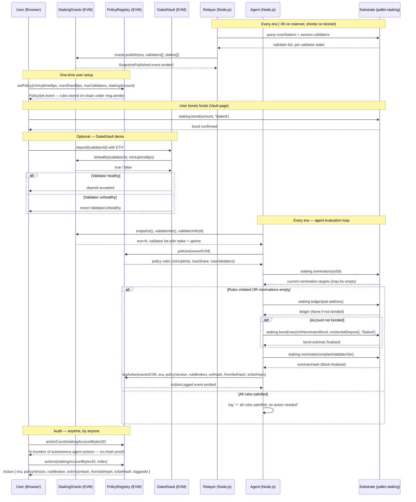

# Potake

**Automated staking policy agent for Polkadot — built on Portaldot V3 (pallet-revive / PolkaVM)**

> Portaldot Hacker House 2026 · Node Operations & Tooling track

---

## Table of Contents

1. [The Problem](#the-problem)
2. [The Solution](#the-solution)
3. [Who Benefits](#who-benefits)
4. [How It Works — End to End](#how-it-works--end-to-end)
5. [Architecture](#architecture)
6. [Sequence Diagram](#sequence-diagram)
7. [Smart Contracts](#smart-contracts)
8. [Off-chain Services](#off-chain-services)
9. [Frontend](#frontend)
10. [Deployed Contracts](#deployed-contracts)
11. [Policy Rules](#policy-rules)
12. [Key Design Decisions](#key-design-decisions)
13. [Quick Start](#quick-start)
14. [Project Structure](#project-structure)
15. [Limits & Trust Model](#limits--trust-model)
16. [License](#license)

---

## The Problem

Polkadot staking is entirely manual today.

When you nominate validators on Polkadot you pick a set of validators by hand. There is no automatic rebalancing. If any nominated validator goes offline, gets slashed, or becomes over-subscribed — **nothing happens automatically**. You have to check back every era (~6 hours on mainnet) and re-nominate by hand.

Most stakers set their nominations once and forget. The result is:

- Missed rewards when a validator goes inactive
- Slash exposure when a validator misbehaves
- Over-concentration of stake on a few popular validators, weakening decentralisation

The second problem is on the builder side. On **Portaldot V3**, Solidity contracts running in PolkaVM cannot read staking data at all. There are no EVM precompiles for validators, eras, or staking rewards. Builders cannot make staking-aware apps, and stakers have no verifiable on-chain record of why their nominations changed.

---

## The Solution

Potake is a **policy-driven, autonomous nomination agent** with on-chain proof of every action it takes.

**You set rules once:**

> "Never nominate a validator with uptime below 95%.  
> Never let one validator hold more than 50% of my stake.  
> Nominate at most 16 validators."

Rules are stored in the `PolicyRegistry` smart contract on-chain under your EVM address.

**The agent enforces them every era:**

1. Reads the latest validator snapshot from `StakingOracle`
2. Reads your policy rules from `PolicyRegistry`
3. Reads your current nominations from the Substrate staking pallet
4. Checks all rules — if any is violated (or nominations are empty), picks a compliant set
5. Signs and submits `staking.nominate` on the Substrate side
6. Calls `registry.logAction(era, ruleBroken, extrinsicHash, fromSet, toSet)` — an immutable on-chain record

Anyone — including hackathon judges — can query `registry.actionCount(stakingKey)` on-chain and see proof that the agent acted autonomously without human intervention.

---

## Who Benefits

| Who | How |
|-----|-----|
| **Retail stakers** | No manual monitoring — policy rules protect their rewards every era |
| **DAOs / treasuries** | Set a compliance policy for managed staking funds programmatically |
| **Validators** | Bad actors and offline nodes get auto-dropped; healthy validators attract more nominations |
| **Polkadot ecosystem** | Stake distributes more evenly across healthy validators — healthier network |
| **Builders** | `IStakingView` interface gives any EVM contract access to live staking data |

---

## How It Works — End to End

| Phase | Who / What | What happens |
|-------|-----------|--------------|
| **1. Deploy** | deployer | `StakingOracle`, `PolicyRegistry`, `GatedVault` deployed to Portaldot V3 via `revive.instantiateWithCode` |
| **2. Set policy** | user (browser) | Opens Policy page → sets minUptime, maxShare, maxValidators → signs EVM tx → `PolicyRegistry.setPolicy()` stores rules on-chain |
| **3. Bond funds** | user (browser) | Opens Vault page → bonds tPOT on the Substrate side so the account can nominate |
| **4. Relayer runs** | relayer (Node.js) | Every era: reads `erasStakers` + `session.validators` from Substrate → calls `oracle.publish(era, validators, stakes)` → staking data is now live on EVM |
| **5. Agent evaluates** | agent (Node.js) | Reads oracle snapshot + policy rules + current nominations → checks 3 rules |
| **6. Agent acts** | agent (Node.js) | On any violation: auto-bonds if needed → submits `staking.nominate(compliantSet)` on Substrate → calls `registry.logAction(...)` on EVM |
| **7. Audit** | anyone | `registry.actionCount(key)` and `registry.actions(key, i)` give full immutable history: era, rule broken, extrinsic hash, before/after nomination sets |

---

## Architecture

```
┌──────────────────────────────────────────────────────────────────────┐
│                          Browser (Next.js 14)                         │
│                                                                        │
│   Landing page   ──►  Dashboard                                        │
│                        ├── Oracle page  (live validator data, agent   │
│                        │                 action counter)              │
│                        ├── Policy page  (set staking rules on-chain)  │
│                        └── Vault page   (bond / unbond / withdraw)    │
│                                                                        │
│   WalletButton (RainbowKit)  ──  wagmi v2  ──  ethers v6              │
│   WorldCanvas (Three.js 3D)  on every dashboard page                  │
└────────────────────────────┬─────────────────────────────────────────┘
                             │ EVM transactions + eth_call
                             ▼
┌──────────────────────────────────────────────────────────────────────┐
│                  Portaldot V3 — EVM layer (pallet-revive / PolkaVM)   │
│                                                                        │
│  ┌─────────────────────┐   ┌──────────────────────────────────────┐  │
│  │   StakingOracle.sol  │   │          PolicyRegistry.sol           │  │
│  │                      │   │                                       │  │
│  │  snapshot()          │   │  setPolicy(...)                       │  │
│  │  validatorIds()      │   │  policies(owner)  → rules             │  │
│  │  validatorInfo(id)   │   │  logAction(...)   → append-only log   │  │
│  │  isHealthy(id, bps)  │   │  actionCount(key) → proof of activity │  │
│  │  stakeShareBps(id)   │   │  actions(key, i)  → full audit trail  │  │
│  └──────────┬───────────┘   └──────────────────────────────────────┘  │
│             │ IStakingView                                              │
│  ┌──────────▼───────────┐                                              │
│  │     GatedVault.sol   │  ← demo: deposit only if validator healthy   │
│  └──────────────────────┘                                              │
└──────────┬────────────────────────────────┬─────────────────────────-┘
           │ eth_call / eth_sendTransaction  │ eth_call / logAction
           │                                 │
┌──────────▼───────────┐       ┌────────────▼──────────────────────────┐
│  Relayer (Node.js)    │       │         Agent (Node.js)                │
│                       │       │                                        │
│  Every era:           │       │  Every era:                            │
│  1. reads Substrate   │       │  1. reads oracle snapshot              │
│  2. publishes to      │       │  2. reads policy rules                 │
│     StakingOracle     │       │  3. reads current nominations          │
│                       │       │  4. evaluates 3 rules                  │
│                       │       │  5. if violated:                       │
│                       │       │     a. bond (if not bonded)            │
│                       │       │     b. staking.nominate(compliantSet)  │
│                       │       │     c. registry.logAction(...)         │
└──────────┬────────────┘       └─────────────────┬──────────────────--┘
           │                                       │
           │ query: erasStakers, session.validators│ extrinsic: staking.nominate
           ▼                                       ▼
┌──────────────────────────────────────────────────────────────────────┐
│                Portaldot V3 — Substrate layer (pallet-staking)        │
│                                                                        │
│  erasStakers  ·  session.validators  ·  staking.nominators            │
│  staking.bond  ·  staking.nominate                                     │
└──────────────────────────────────────────────────────────────────────┘
```

---

## Sequence Diagram



---

## Smart Contracts

### `IStakingView` — Read Interface

The stable consumer-facing interface. All contracts that need staking data depend only on this. If Portaldot V3 ever ships a native staking precompile, a new implementation can swap in behind this interface without changing any consumer.

```solidity
interface IStakingView {
    struct Snapshot {
        uint32  era;
        uint64  relayedAt;        // block timestamp when relayer published
        uint16  validatorCount;
        bytes32 validatorSetHash; // keccak256(abi.encode(validatorIds))
        uint256 totalStake;       // network-wide, 14 decimals
        uint256 eraReward;
    }

    struct ValidatorInfo {
        uint128 totalStake;
        uint16  commissionBps;
        uint16  uptimeBps;
        bool    active;
    }

    function latestEra()                                        external view returns (uint32);
    function snapshot()                                         external view returns (Snapshot memory);
    function validatorIds()                                     external view returns (bytes32[] memory);
    function validatorInfo(bytes32 validator)                   external view returns (ValidatorInfo memory);
    function isHealthy(bytes32 validator, uint16 minUptimeBps) external view returns (bool);
    function stakeShareBps(bytes32 validator)                   external view returns (uint16);
}
```

---

### `StakingOracle` — On-chain Staking Snapshot

Holds the latest per-era validator snapshot published by the relayer. Storage design: only one snapshot is kept (overwritten each era) and full history lives in events. This avoids unbounded storage deposit growth under Revive.

Key functions:

| Function | Who calls | What it does |
|----------|-----------|-------------|
| `publish(era, ids[], stakes[], commissions[], uptimes[], actives[])` | relayer | Overwrites snapshot for the new era; emits `SnapshotPublished` + per-validator `ValidatorUpdated` events |
| `snapshot()` | anyone | Returns the latest `Snapshot` struct |
| `validatorIds()` | anyone | Returns `bytes32[]` of all listed validator AccountId32s |
| `validatorInfo(id)` | anyone | Returns `ValidatorInfo` for one validator |
| `isHealthy(id, minUptimeBps)` | GatedVault, agent | True if validator is active and uptime ≥ threshold |
| `stakeShareBps(id)` | agent | Validator's share of total stake in basis points |

---

### `PolicyRegistry` — Rules + Immutable Action Log

Stores each user's staking policy and an append-only log of every action the agent takes on their behalf.

**Policy struct:**

| Field | Type | Meaning |
|-------|------|---------|
| `stakingAccount` | `bytes32` | Substrate `AccountId32` the agent manages (SS58 encoded as 32-byte key) |
| `maxShareBps` | `uint16` | Max stake share any one nominated validator may have (basis points) |
| `minUptimeBps` | `uint16` | Minimum uptime every nominated validator must meet |
| `maxValidators` | `uint8` | Max number of validators to nominate (0 = unlimited) |
| `version` | `uint32` | Auto-increments on every `setPolicy` call |
| `active` | `bool` | False until first `setPolicy`; can be deactivated |

**Action struct (append-only log):**

| Field | Type | Meaning |
|-------|------|---------|
| `era` | `uint32` | Era in which the agent acted |
| `policyVersion` | `uint32` | Policy version active at the time |
| `ruleBroken` | `uint8` | Which rule triggered the action (1=maxShare, 2=minUptime, 3=maxValidators) |
| `extrinsicHash` | `bytes32` | Hash of the `staking.nominate` Substrate extrinsic |
| `fromSetHash` | `bytes32` | `keccak256(abi.encode(nominationsBefore))` |
| `toSetHash` | `bytes32` | `keccak256(abi.encode(nominationsAfter))` |
| `loggedAt` | `uint64` | Block timestamp |

Key functions:

| Function | Who calls | What it does |
|----------|-----------|-------------|
| `setPolicy(stakingAccount, maxShareBps, minUptimeBps, maxValidators)` | user | Stores/updates policy; increments version; emits `PolicySet` |
| `deactivatePolicy()` | user | Marks policy inactive; agent will skip this account |
| `logAction(owner, era, policyVersion, ruleBroken, extHash, fromSetHash, toSetHash)` | agent | Appends one `Action` to the immutable log |
| `actionCount(stakingAccount)` | anyone | Returns number of agent actions for this account — **on-chain proof** |
| `actions(stakingAccount, index)` | anyone | Returns one `Action` entry by index |

---

### `GatedVault` — Demo Consumer

A minimal demo showing any EVM contract can consume `IStakingView`. Accepts a deposit earmarked for a validator only if that validator is currently healthy according to the oracle. Rejects with `ValidatorUnhealthy` if not.

```
deposit(validatorId)  →  oracle.isHealthy(validatorId, minUptimeBps)  →  accept / revert
withdraw(validatorId, amount)
```

This exists to prove the `IStakingView` interface is composable — a lending protocol, a liquid staking vault, or a staking yield optimizer could all use it the same way.

---

## Off-chain Services

### Relayer (`src/relayer/`)

Reads from Substrate, writes to the oracle EVM contract.

```
Every 30s:
  1. query api.query.staking.erasStakers(currentEra)
  2. query api.query.session.validators()
  3. if era changed → oracle.publish(era, validatorData)
  4. emit SnapshotPublished on-chain
```

Run: `node src/index.mjs relay`

---

### Policy Agent (`src/agent/`)

Evaluates the managed account's nominations against its policy and acts if any rule is broken.

**Files:**

| File | Role |
|------|------|
| `agent/index.mjs` | Orchestrator — loads snapshot, policy, keypair; calls evaluate + nominate |
| `agent/evaluate.mjs` | Pure evaluation — checks 3 rules, builds compliant suggestion set |
| `agent/nominate.mjs` | Submits `staking.bond` (if needed) + `staking.nominate` + `registry.logAction` |

**Evaluation logic (`evaluate.mjs`):**

```
Rule 0: currentNominations.length === 0          → always a violation
Rule 2: any nominator has uptimeBps < minUptimeBps → violation
Rule 1: any nominator stakeShareBps > maxShareBps  → violation
Rule 3: nominationCount > maxValidators            → violation

suggestedSet = validators filtered to: active=true, uptime≥min, share≤max
             → sorted by totalStake desc
             → sliced to maxValidators
```

Run: `node src/index.mjs agent <keystore.json>`

---

## Frontend

Built with **Next.js 14 App Router**, **wagmi v2**, **RainbowKit**, **ethers v6**, **Three.js**.

### Layout

```
app/
├── page.tsx                   Landing page (cinematic two-column, connect wallet)
└── (dashboard)/
    ├── layout.tsx             Shared shell: nav, 3D WorldCanvas, wallet state
    ├── DashboardContext.tsx   Shared state: address, provider, policy, oracle snapshot
    ├── oracle/page.tsx        Live validator data + agent nominations counter
    ├── policy/page.tsx        Set / update staking policy
    └── vault/page.tsx         Bond / unbond / withdraw staking funds
```

### Components

| Component | What it does |
|-----------|-------------|
| `WorldCanvas.tsx` | Three.js scene — LatheGeometry pot, CylinderGeometry validator pillars, agent sphere — visible on all dashboard pages |
| `WalletButton.tsx` | Custom sandal-styled button wrapping `ConnectButton.Custom` from RainbowKit |
| `Providers.tsx` | `WagmiProvider` + `QueryClientProvider` + `RainbowKitProvider` (dark theme, orange accent) |
| `TxLink.tsx` | Inline transaction hash chip — click to copy, link to node console |
| `GridBackground.tsx` | CSS grid overlay for the dark background |

### Wallet Integration

- **RainbowKit** handles the wallet picker modal (MetaMask, Talisman, WalletConnect, etc.)
- **wagmi v2** `useAccount` + `useDisconnect` manage connection state
- After connect, `DashboardContext` creates an `ethers.BrowserProvider(window.ethereum)` for contract calls
- Chain: Portaldot V3 — Chain ID `420420777`, defined via `viem.defineChain`

---

## Deployed Contracts (Portaldot V3 Testnet)

| Contract | Address |
|----------|---------|
| **StakingOracle** | `0x0bfB6f131A99D5aaA3071618FFBD5bb3ea87C619` |
| **PolicyRegistry** | `0x68283AAa8899A4aA299141ca6f04dF8e5802509f` |

> **Network:** Portaldot V3 Testnet  
> **Chain ID:** `420420777`  
> **EVM RPC:** `https://test-evm-rpc-v3.portaldot.dev`  
> **Substrate WS:** `wss://test-node-v3.portaldot.dev`

**Live activity:**

- Oracle snapshot: ERA 55 — 2 validators — `~2.02 × 10¹⁸` planck total stake
- Policy set for `0x588F6b3169F60176c1143f8BaB47bCf3DeEbECdc` (v5: minUptime=9500, maxShare=5000, maxValidators=16)
- Agent bonded `10,000,000,000,000` planck and nominated 2 validators
- `actionCount` = 1 (verifiable on-chain, block `197667`)

---

## Policy Rules

| Constant | Value | Meaning |
|----------|-------|---------|
| *(Rule 0)* | — | Zero nominations always triggers a violation — policy requires at least one nomination |
| `RULE_MAX_SHARE` | `1` | No single nominated validator holds more than `maxShareBps` of total stake |
| `RULE_MIN_UPTIME` | `2` | Every nominated validator must have `uptimeBps ≥ minUptimeBps` |
| `RULE_MAX_VALIDATORS` | `3` | Total nominated validators must not exceed `maxValidators` |

Basis points: `10000 bps = 100%`. Example: `minUptimeBps = 9500` means ≥ 95% uptime required.

---

## Key Design Decisions

**No staking precompile on Portaldot V3.**  
There are no EVM precompiles for staking data. The relayer bridges this: it reads `erasStakers` on the Substrate side and writes it into `StakingOracle` via an EVM transaction. Consumers only see `IStakingView` — if a native precompile appears later, only the implementation swaps, not the consumers.

**Latest-slot oracle storage.**  
The oracle overwrites one fixed snapshot per era. Append-only would grow the number of storage slots on every era, and Revive charges a deposit per slot. Events handle history at no extra slot cost.

**EVM bytecode deployment (not PolkaVM bytecode).**  
Portaldot V3 uses PolkaVM. Contracts are deployed via `revive.instantiateWithCode` Substrate extrinsic (not `eth_sendRawTransaction`). Using EVM bytecode with `allowEVMBytecode: true` requires ~238 tPOT storage deposit vs ~1,645 tPOT for PolkaVM bytecode — a 7× saving.

**Dynamic gas estimation.**  
Revive's `eth_estimateGas` returns Substrate weight units (not EVM gas). All contract calls run `provider.estimateGas()` first and pass the result directly as `gasLimit`. Never hard-code gas limits.

**SS58 / EVM address split.**  
The policy is owned by an EVM address (`0x588F…`). The bonded funds and nominations live on a separate Substrate SS58 account (`5Ejta…`). The agent resolves both: EVM address from `MANAGED_ACCOUNTS`, SS58 from `STAKING_ACCOUNT_SS58` env or by decoding `policy.stakingAccount` from the registry.

**Auto-bond on first nomination.**  
If the staking account has no bond, the agent queries `minNominatorBond` and `existentialDeposit` from the chain and bonds `max(minBond, ed)`. This means a fresh account with only a fund transfer can be nominated without any manual bonding step.

---

## Quick Start

```bash
# 1. Install dependencies
cd backend && npm install
cd ../frontend && npm install

# 2. Configure backend
cp backend/.env.example backend/.env
# Fill in:
#   RELAYER_PRIVATE_KEY=0x...   (EVM signer for relayer + agent logAction)
#   ORACLE_ADDRESS=0x...
#   REGISTRY_ADDRESS=0x...
#   MANAGED_ACCOUNTS=0x...      (EVM address whose policy the agent manages)
#   STAKING_ACCOUNT_SS58=5...   (Substrate SS58 that holds the bonded stake)

# 3. Run tests (no network needed)
cd backend && npm test          # 28 unit tests pass

# 4. Start the relayer (publishes oracle snapshot each era)
node src/index.mjs relay

# 5. Run the policy agent
node src/index.mjs agent <path/to/keystore.json>

# 6. Start the frontend
cd frontend && npm run dev      # http://localhost:3000
```

---

## Project Structure

```
Potake/
├── backend/
│   ├── contracts/
│   │   ├── IStakingView.sol         read interface
│   │   ├── StakingOracle.sol        per-era validator snapshot
│   │   ├── PolicyRegistry.sol       user rules + action log
│   │   └── GatedVault.sol           demo IStakingView consumer
│   ├── src/
│   │   ├── index.mjs                CLI entry (relay / agent / status)
│   │   ├── config.mjs               env vars
│   │   ├── chain/
│   │   │   ├── substrate.mjs        @polkadot/api connection
│   │   │   └── evm.mjs              ethers provider + contract factories
│   │   ├── relayer/                 Substrate → oracle publish loop
│   │   └── agent/
│   │       ├── index.mjs            orchestrator
│   │       ├── evaluate.mjs         rule evaluation + suggestion set
│   │       └── nominate.mjs         bond + nominate + logAction
│   └── test/                        28 Hardhat unit tests
│
└── frontend/
    ├── app/
    │   ├── layout.tsx               root layout (Providers)
    │   ├── page.tsx                 landing page
    │   └── (dashboard)/
    │       ├── layout.tsx           shared dashboard shell + 3D canvas
    │       ├── DashboardContext.tsx shared state
    │       ├── oracle/page.tsx      live oracle data + agent counter
    │       ├── policy/page.tsx      set staking policy
    │       └── vault/page.tsx       bond / unbond / withdraw
    ├── components/
    │   ├── WorldCanvas.tsx          Three.js 3D scene
    │   ├── WalletButton.tsx         RainbowKit custom button
    │   ├── Providers.tsx            wagmi + RainbowKit providers
    │   ├── TxLink.tsx               clickable tx hash chip
    │   └── GridBackground.tsx       dark grid CSS background
    └── lib/
        ├── wagmiConfig.ts           Portaldot V3 chain + wagmi config
        └── contracts.ts             contract addresses + ABIs
```

---

## Limits & Trust Model

- **The agent is trusted.** The registry records what it did — it cannot force the agent to follow the policy. This is an audit trail, not enforcement.
- **No cross-chain proof.** The registry does not prove the EVM address controls the Substrate staking account. That link is asserted by the user when setting `stakingAccount` in the policy.
- **Testnet scope.** Portaldot V3 has very few validators. The policy rules demonstrate guardrails and produce an audit trail, but cannot optimise stake at scale.
- **Uptime data.** Uptime is currently hardcoded at 100% in oracle data. ImOnline-based uptime from Substrate events is a planned improvement.
- **Single relayer / agent.** There is no redundancy. For production, a multi-operator model with economic incentives would be needed.

---

## Third-party Software

| Package | License |
|---------|---------|
| Hardhat | MIT |
| ethers.js v6 | MIT |
| `@polkadot/api` v16 | Apache-2.0 |
| `@parity/resolc` v1.4.0 | Apache-2.0 |
| `@rainbow-me/rainbowkit` v2 | MIT |
| wagmi v2 | MIT |
| viem v2 | MIT |
| Next.js 14 | MIT |
| Three.js | MIT |
| `@tanstack/react-query` v5 | MIT |
| dotenv | BSD-2-Clause |

## License

MIT
