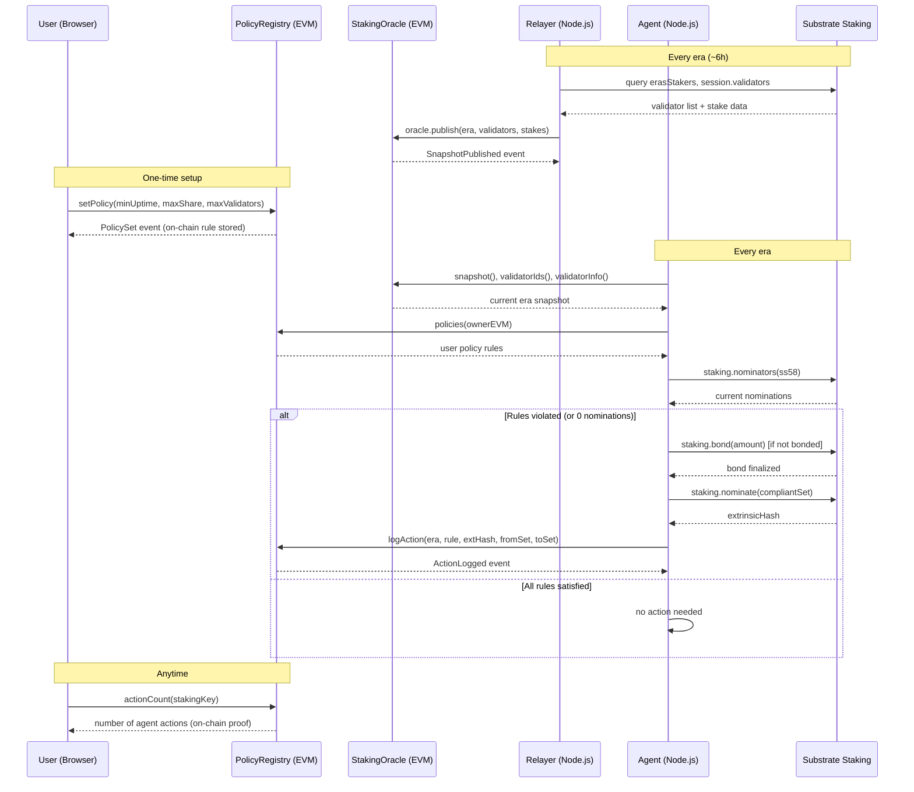

# Potake

**Automated staking policy agent for Polkadot — built on Portaldot V3 (pallet-revive / PolkaVM).**

Portaldot Hacker House 2026 · Node Operations & Tooling track

---

## The Problem

Polkadot staking is entirely manual today.

When you nominate validators on Polkadot:

- You pick validators by hand, once
- If a validator goes offline, gets slashed, or becomes over-subscribed — **nothing happens automatically**
- You have to manually monitor and re-nominate every era (~6 hours)
- Most stakers just set it once and forget → they bleed rewards or get slashed

There is no "set rules, let it manage itself" system. And on Portaldot V3, EVM contracts cannot even read staking data — there are no staking precompiles — so builders cannot make staking-aware apps at all.

---

## The Solution

Potake is a **policy-driven, autonomous nomination agent** with on-chain proof of every action.

You define rules once:

> "Never nominate a validator with uptime below 95%. Never let one validator hold more than 50% of my stake. Nominate at most 16 validators."

The agent monitors every era and **automatically re-nominates** if any rule is broken. Every action is recorded on-chain so anyone — judges, auditors, users — can verify what happened and why.

### Who benefits

| Who | How |
|-----|-----|
| **Retail stakers** | No manual monitoring — rules protect rewards automatically |
| **DAOs / treasuries** | Programmatic staking compliance for managed funds |
| **Validators** | Bad actors get auto-dropped; healthy validators get more nominations |
| **Polkadot ecosystem** | Healthier, more decentralised validator set |

---

## Architecture

```
┌─────────────────────────────────────────────────────────────┐
│                        USER (Browser)                        │
│  Policy Page: set rules  │  Vault Page: manage bonded funds  │
│  Oracle Page: see agent actions + live validator data        │
└──────────────────┬──────────────────────────────────────────┘
                   │ EVM tx (wagmi / ethers v6)
                   ▼
┌──────────────────────────────────┐
│        PolicyRegistry.sol        │  ← stores user rules + append-only action log
│        StakingOracle.sol         │  ← per-era validator snapshot
│        GatedVault.sol            │  ← demo: only accepts deposits if oracle is fresh
└──────┬───────────────────────────┘
       │ eth_call / eth_getLogs (EVM RPC)
       ▼
┌──────────────────────────────────┐
│     Off-chain Node.js services   │
│                                  │
│  Relayer ──── reads Substrate ───┼──► oracle.publish(era, validators, stakes)
│  Agent  ──── reads policy + ─────┼──► staking.nominate(targets)  [Substrate]
│               oracle snapshot    │    registry.logAction(...)     [EVM]
└──────────────────────────────────┘
       │
       ▼
┌──────────────────────────────────┐
│     Substrate (pallet-staking)   │
│  erasStakers, session.validators │
│  staking.nominate extrinsic      │
└──────────────────────────────────┘
```

---

## Sequence Diagram



---

## Deployed Contracts (Portaldot V3 Testnet)

| Contract | Address |
|----------|---------|
| StakingOracle | `0x0bfB6f131A99D5aaA3071618FFBD5bb3ea87C619` |
| PolicyRegistry | `0x68283AAa8899A4aA299141ca6f04dF8e5802509f` |

> Network: Portaldot V3 · Chain ID: `420420777` · EVM RPC: `https://test-evm-rpc-v3.portaldot.dev`

---

## Frontend Pages

### Policy Page

The Policy page is where users define their staking rules on-chain.

- Set `minUptimeBps` — minimum validator uptime required (e.g. `9500` = 95%)
- Set `maxShareBps` — maximum stake share a single validator can hold (e.g. `5000` = 50%)
- Set `maxValidators` — maximum number of validators to nominate at once

Submitting calls `registry.setPolicy(...)` — an EVM transaction that stores the rules permanently in `PolicyRegistry` under the user's EVM address. The agent reads this policy every era and acts within its constraints. The user, not the agent, defines what "compliant" means.

### Vault Page

The Vault page shows and manages the bonded funds backing the staking policy.

- View bonded balance, free balance, and current staking status
- **Bond more** — lock additional funds into staking
- **Unbond** — start the unbonding period (28 days on mainnet, shorter on testnet)
- **Withdraw** — claim funds after unbonding completes
- **Rebond** — cancel an unbond and return funds to active staking

The agent's `staking.nominate` extrinsic only works if funds are bonded. The vault is the financial backing for the entire policy system. If the account is not bonded, the agent auto-bonds the minimum required amount on first run.

### Oracle Page

Live view of the oracle snapshot and agent activity.

- Current era, total stake, validator list with uptime and commission
- **Agent Nominations counter** — polls `registry.actionCount(stakingKey)` every 15 seconds, providing on-chain proof of autonomous agent activity that judges and auditors can verify independently

---

## Policy Rules

| Rule | Constant | Meaning |
|------|----------|---------|
| `RULE_MIN_UPTIME = 2` | 2 | Every nominated validator must have `uptimeBps ≥ minUptimeBps` |
| `RULE_MAX_SHARE = 1` | 1 | No single validator may hold more than `maxShareBps` of total stake |
| `RULE_MAX_VALIDATORS = 3` | 3 | Total nominated validators must not exceed `maxValidators` |
| *(Rule 0)* | 0 | Zero nominations always triggers a violation |

---

## Quick Start

```bash
npm install
cp .env.example .env   # fill DEPLOYER_PRIVATE_KEY, ORACLE_ADDRESS, REGISTRY_ADDRESS

npm test               # 28 unit tests (no network needed)

# Start the relayer (publishes a new oracle snapshot each era):
npm run relay

# Run the policy agent (evaluate → nominate if violated → log action):
node src/index.mjs agent <keystore.json>

# Check chain + oracle status:
npm run status
```

---

## Key Design Decisions

- **No staking precompile on Portaldot V3.** There are no EVM precompiles for staking data. The relayer bridges this by reading `erasStakers` on the Substrate side and publishing to `StakingOracle` via an EVM transaction.
- **Latest-slot oracle storage.** The oracle overwrites one snapshot per era and emits events for history. Append-only would cost too much in Revive storage deposits.
- **Stable `IStakingView` interface.** Consumers call the interface. If a native precompile appears, a new implementation swaps in behind it without changing consumers.
- **EVM bytecode deployment.** Portaldot V3 uses PolkaVM. Deployment goes through `revive.instantiateWithCode` (not `eth_sendRawTransaction`). EVM bytecode requires ~238 tPOT vs ~1,645 tPOT for PolkaVM bytecode.
- **Dynamic gas estimation.** Revive's `eth_estimateGas` returns Substrate weight units. All contract calls use `provider.estimateGas()` and pass the result directly as `gasLimit`.
- **SS58 ↔ EVM address split.** The user's EVM address owns the policy. A separate SS58 account (`STAKING_ACCOUNT_SS58`) holds the bonded funds and signs `staking.nominate`. The agent resolves both from config and on-chain policy storage.

---

## Limits

- The relayer and agent are **trusted off-chain services**. The registry records what they did; it cannot force compliance.
- The registry does not cryptographically prove the EVM owner controls the Substrate staking account.
- The testnet has very few validators; rules demonstrate guardrails and audit trail, not stake optimisation.
- Uptime is currently hardcoded to 100% in oracle data; ImOnline-based uptime is a future improvement.

---

## Third-party Software

Hardhat (MIT), ethers.js v6 (MIT), `@polkadot/api` v16 (Apache-2.0), `@rainbow-me/rainbowkit` (MIT), wagmi v2 (MIT), Next.js 14 (MIT), Three.js (MIT), dotenv (BSD-2-Clause), `@parity/resolc` v1.4.0 (Apache-2.0).

## License

MIT
