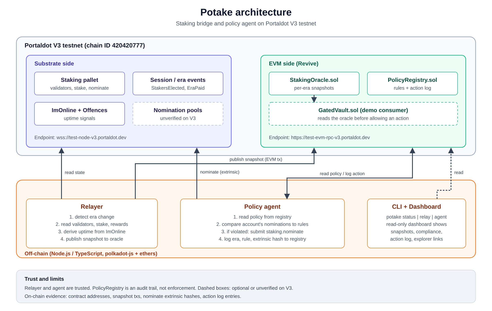

# Potake

Staking bridge and policy agent for **Portaldot V3**. Built for the Portaldot Hacker House 2026 (Node Operations & Tooling track).

> **Status: implementation complete.** All phases A–D are built and unit-tested. Testnet deployment is pending (WS node intermittently rate-limited). This README states what is verified and what is not.

## Problem
On Portaldot V3, Solidity contracts cannot read staking data (validators, eras, rewards). A chain check on Oct 22 found precompiles only for Assets and Vesting, none for staking or pools. A precompile built into Revive itself would not show as a pallet, so this is "none found", not "none exist". Builders cannot make staking-aware apps, and stakers have no verifiable record of why their nominations changed.

Demand from builders is **unproven**.

## What Potake is
| Part | Status |
|---|---|
| `IStakingView`: read interface consumers depend on | written |
| `StakingOracle`: latest per-era snapshot, history in events | written, unit-tested |
| `PolicyRegistry`: user rules + append-only agent action log | written, unit-tested |
| `GatedVault`: demo consumer that checks the oracle before accepting deposits | written, unit-tested |
| Relayer: reads staking state, publishes each era | **built** (`potake relay`) |
| Policy agent: checks rules, submits `nominate`, logs the action | **built** (`potake agent`) |
| CLI: `potake status`, `potake relay`, `potake agent` | **built** |
| Deploy script: `revive.instantiateWithCode` with EVM bytecode | **built** (`npm run deploy:revive`) |
| Read-only dashboard | not built (optional) |



## Phases of working

### How the system runs
| Phase | When | What happens | Where it is visible |
|---|---|---|---|
| **0. Setup** | once | Deploy the contracts. The owner sets a policy in `PolicyRegistry` (managed account, max share per validator, min uptime, max validators). The managed account is a nomination pool where the agent holds only the nominator role | Deploy txs, `PolicySet` event |
| **1. Sync** | every era (about 6 h) | Relayer detects the new era, reads validators, stake, commission and rewards, derives uptime from ImOnline events, and publishes the snapshot to `StakingOracle` | `SnapshotPublished` and `ValidatorUpdated` events |
| **2. Evaluate** | every era | Agent reads the policy and the account's current nominations, computes each validator's share, and compares them to the rules | `potake status` |
| **3. Act** | only if a rule is broken | Agent picks a compliant validator set and submits `staking.nominate` | Substrate extrinsic hash |
| **4. Audit** | after every action | Agent logs era, rule broken, policy version, extrinsic hash and before/after set hashes in `PolicyRegistry` | `ActionLogged` event, explorer |
| **5. Consume** | any time | Other contracts read staking data through `IStakingView`. The demo `GatedVault` refuses deposits for unhealthy validators | Vault reverts / `Deposited` event |

If no rule is broken, phases 3 and 4 are skipped and the agent waits for the next era.

### How the build is staged
| Phase | Deliverable | Target | Status |
|---|---|---|---|
| **A. Contracts** | `IStakingView`, `StakingOracle`, `PolicyRegistry`, `GatedVault`, 18 unit tests | done | **Done** |
| **B. Deploy** | Contracts on the Portaldot V3 testnet, addresses and tx hashes in this README | Oct 23 | Script built; pending node availability |
| **C. Relayer** | `potake relay` publishes a real era to the oracle | Oct 23 | **Built** (gas estimation, retry logic) |
| **D. Agent** | Evaluate 3 rules, submit `staking.nominate`, log action in registry | Oct 23–24 | **Built** (28 unit tests passing) |
| **E. Check-in** | 3-minute demo video, diagram, README, submission | Oct 24, 12:00 UTC (17:30 IST) | Pending |
| **F. Polish** | Uptime rule from ImOnline, live `GatedVault` demo, `potake status`, optional dashboard | Oct 25 - Nov 5 | Pending |
| **G. Final** | Pitch deck, final README and video, no large last-minute commits | Nov 6, 04:00 UTC (09:30 IST) | Pending |

Update the Status column as each phase finishes.

## Design notes
- **Latest-slot storage.** The oracle overwrites one fixed snapshot each era and emits events for history, because Revive storage deposits grow with new storage.
- **Stable interface.** Consumers call `IStakingView`. If a native staking precompile appears, an implementation can swap in behind it.

## Quick start
```bash
npm install
cp .env.example .env        # fill in DEPLOYER_PRIVATE_KEY and SUBSTRATE_WS
npm test                    # 28 unit tests (no network required)

# Deploy to Portaldot V3 testnet (needs tPOT on the deployer's sr25519 account):
npm run deploy:revive <keystore.json>
# → writes deployments.json with addresses; copy to .env

# Start the relayer (reads live staking state each era, publishes to oracle):
npm run relay

# Run the policy agent (evaluate, nominate if needed, log action):
npm run agent [keystore.json] [--dry-run]

# Check chain + oracle status:
npm run status
```

Deployed contracts (fill in after deploying to testnet):

| Contract | Address |
|---|---|
| StakingOracle | `0x0bfB6f131A99D5aaA3071618FFBD5bb3ea87C619` |
| PolicyRegistry | `0x68283AAa8899A4aA299141ca6f04dF8e5802509f` |
| GatedVault | deployed alongside registry |

> Network: Portaldot V3 · Chain ID 420420777

## Limits
- The relayer and agent are **trusted**. The registry records what they did; it cannot force them to follow a policy.
- The registry does not prove the EVM owner controls the Substrate staking account.
- The testnet has very few validators (2 on Oct 22), so policies show guardrails and an audit trail, not optimisation.
- Bonded tokens stay locked for a long time (unbonding was reported at 672 eras, about 168 days). Bond the minimum.
- EVM bytecode deployment on Portaldot V3 is assumed from the official guide; the first testnet deploy confirms it.

## Third-party software
Hardhat (MIT), ethers (MIT), polkadot-js `@polkadot/api` (Apache-2.0), dotenv (BSD-2-Clause).

## License
MIT
